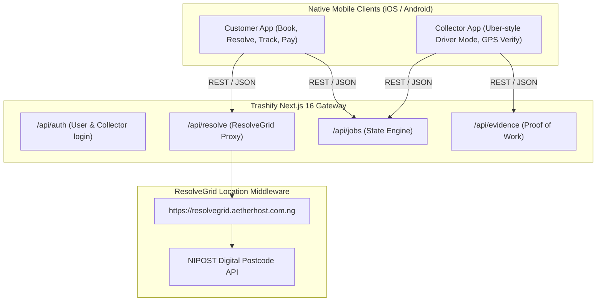

# Trashify Mobile Application Architecture (Uber-Style App)

Trashify is designed as a **Universal Platform**:
1. **Web App**: Accessible via browser for any resident, business, or municipal administrator.
2. **Progressive Web App (PWA)**: Installable directly onto mobile home screens from the browser without App Store approval (already configured in `public/manifest.json`).
3. **Native iOS & Android Mobile Apps**: Distributed via Apple App Store & Google Play Store.

---

## Architecture: How Web & Mobile Consume ResolveGrid



---

## Path 1: Instant Native Mobile App via Capacitor (Fastest Path to Store)

Using Capacitor wraps the Next.js app into authentic native Xcode (iOS) and Android Studio (Android) projects with native device access (GPS, Camera, Push Notifications).

### 1. Install Capacitor in Trashify
```bash
cd /Users/yusufabubakar/Documents/trashify
pnpm add @capacitor/core @capacitor/cli @capacitor/geolocation @capacitor/camera @capacitor/push-notifications
pnpm cap init "Trashify" "ng.trashify.app"
```

### 2. Add Native Platforms
```bash
pnpm add @capacitor/ios @capacitor/android
pnpm cap add ios
pnpm cap add android
```

### 3. Open in Xcode or Android Studio
```bash
pnpm cap open ios
pnpm cap open android
```

---

## Path 2: Dedicated Expo / React Native App (`/mobile`)

For maximum native performance with dedicated background driver location tracking:

### Project Scaffold
```text
trashify/
├── app/                  # Next.js 16 Web & API
├── lib/                  # Shared Business Logic & ResolveGrid Client
└── mobile/               # React Native / Expo App
    ├── app/
    │   ├── (customer)/   # Resident screens
    │   └── (collector)/  # Uber-driver mode screens
    ├── package.json
    └── app.json
```

### Sample Mobile API Client (`mobile/lib/api.ts`)
```typescript
const BASE_URL = 'https://trashify.aetherhost.com.ng'; // Or your deployed URL

export async function resolveAddress(query: string) {
  const res = await fetch(`${BASE_URL}/api/resolve?q=${encodeURIComponent(query)}`);
  return res.json();
}

export async function submitVerification(jobId: string, pin: string, coords: any) {
  const res = await fetch(`${BASE_URL}/api/evidence`, {
    method: 'POST',
    headers: { 'Content-Type': 'application/json' },
    body: JSON.stringify({ jobId, submittedCode: pin, gpsCoords: coords })
  });
  return res.json();
}
```
