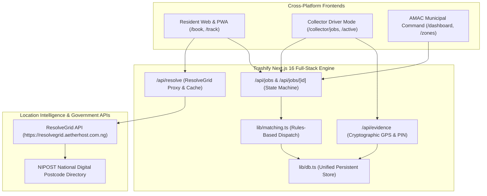

# Trashify — The "Uber for Waste" on Nigeria's Digital Postcode

> Powered by **Next.js 16 (App Router & Turbopack)**, **ResolveGrid Location Intelligence**, and the **NIPOST National Digital Postcode**.

Trashify transforms informal Nigerian landmark descriptions (such as *"Yellow duplex near Banex, Wuse 2"*) into verified 6-digit NIPOST postcodes (`900211`), matches requests to licensed local collectors, provides explainable dispatch ETAs, and enforces NDPA-compliant cryptographic proof-of-work (GPS boundary + 4-digit customer PIN handshake).

Built for the **3MTT Nigeria Knowledge & Innovation Showcase**, Trashify operates seamlessly across responsive Web, installable Progressive Web App (PWA), and native iOS/Android packaging via Capacitor & React Native.

---

## Architecture Overview



---

## Key Pillars & System Capabilities

### 1. ResolveGrid × NIPOST Landmark Geocoding (`lib/resolvegrid.ts`)
- **Informal to Official Translation:** Resolves conversational landmarks into standardized addresses with area, LGA (AMAC), state (FCT — Abuja), confidence score (0.0–1.0), and official NIPOST 6-digit postcode (e.g. `900211` for Wuse 2).
- **Tier 1–5 Geometry Awareness:** Explicitly handles NIPOST Tier 4 (Centroid & Landmark Boundary) and Tier 5 (Exact Premise Point Geometry).
- **Resilient Fallback & In-Memory LRU Cache:** Queries `https://resolvegrid.aetherhost.com.ng` with automatic timeout protection and deterministic, NIPOST-compliant pilot fixtures for Abuja metropolitan zones (Wuse 2, Maitama, Garki 1, Asokoro, Jabi Lake, Gwarinpa).

### 2. Explainable Dispatch & Fair Payouts
- **Transparent Arrival Multipliers:** Replaces opaque algorithms with transparent, explainable ETA calculation:
  $$\text{ETA} = (\text{Distance (km)} \times \text{Base Drive Time}) \times \text{Urban Traffic Multiplier (1.35x)} + (\text{Prior Stops} \times 6.5\text{ mins})$$
- **Fair Pricing & Recyclable Credits:** Upfront quote based on standard 50L refuse bag volume with automatic rebates for segregated recyclables (plastics, paper, metal).

### 3. Proof-of-Work Handshake (`/api/evidence`)
- **Anti-Ghost Run Protection:** Upon driver arrival, the resident provides a secure **4-digit Handshake PIN** displayed on their screen (e.g. `4821`).
- **GPS Perimeter Verification:** Validates that the collector's device coordinates fall within the registered NIPOST postal boundary before authorizing instant wallet payout.
- **NDPA Compliance:** Cryptographic timestamp and proof token recorded without harvesting unnecessary personal resident tracking data.

### 4. Municipal Governance & Franchise Zones (`/zones`)
- **Territory Allocation:** Maps licensed private waste collectors to specific 6-digit digital postcodes to prevent jurisdictional disputes and ensure 100% municipal coverage.
- **Landfill Diversion Telemetry:** Tracks sorted recyclable tonnage diverted to authorized recyclers for municipal ESG reporting and carbon credit auditing.

---

## Application Structure (Next.js 16 App Router)

```text
trashify/
├── app/
│   ├── (auth)/
│   │   ├── login/page.tsx               # Switchable portal login (Resident, Collector, AMAC Admin)
│   │   └── register/page.tsx            # Multi-persona registration with primary zone selection
│   ├── (customer)/
│   │   ├── book/page.tsx                # Interactive landmark lookup + quote + waste categories
│   │   └── track/[jobId]/page.tsx       # Live explainable ETA, driver profile & 4-digit PIN
│   ├── (collector)/
│   │   ├── jobs/page.tsx                # Uber Driver-style board, zone filters & earnings
│   │   └── active/[jobId]/page.tsx      # Turn-by-turn navigation & PIN + GPS handshake
│   ├── (admin)/
│   │   ├── dashboard/page.tsx           # Ops console, tons diverted, SLA compliance table
│   │   └── zones/page.tsx               # NIPOST postcode-to-collector allocation matrix
│   ├── api/
│   │   ├── resolve/route.ts             # ResolveGrid landmark resolution proxy
│   │   ├── jobs/route.ts                # CRUD + auto-dispatch matching
│   │   ├── jobs/[id]/route.ts           # Single job status updates
│   │   ├── evidence/route.ts            # PIN & GPS verification handshake
│   │   ├── collectors/route.ts          # Fleet & online status
│   │   └── zones/route.ts               # Municipal zone performance stats
│   ├── layout.tsx                       # Universal navbar, mobile bottom dock & PWA prompt
│   └── page.tsx                         # Landing page + 6-step lifecycle walkthrough
├── components/
│   ├── address-resolver.tsx             # Interactive ResolveGrid query card with presets
│   ├── collector-job-card.tsx           # Driver dispatch card with postcode & earnings
│   ├── navbar.tsx                       # Desktop responsive navigation
│   ├── mobile-nav.tsx                   # Uber-style mobile bottom navigation bar
│   ├── pwa-install-prompt.tsx           # "Install Trashify App" prompt (iOS/Android)
│   └── ui/                              # High-credibility Button, Card, and Badge components
├── lib/
│   ├── db.ts                            # Unified persistent in-memory/database store
│   ├── matching.ts                      # Rules-based collector selection engine
│   ├── resolvegrid.ts                   # ResolveGrid client, caching & NIPOST fixtures
│   ├── store.ts                         # Initial seed records for Abuja pilot
│   └── types.ts                         # Strict TypeScript contracts
├── capacitor.config.json                # Native mobile app configuration
└── public/
    ├── manifest.json                    # PWA installation manifest
    └── sw.js                            # Offline caching service worker
```

---

## Universal Mobile Strategy ("Uber for Waste")

Trashify is designed from day one to operate on mobile phones with zero friction:

### Option 1: Progressive Web App (PWA) — Instant Mobile Install
- Configured with `public/manifest.json` and service worker caching (`public/sw.js`).
- Any user visiting `trashify.ng` on **iOS (Safari)** or **Android (Chrome)** receives an automatic prompt to tap **"Install App"** / **"Add to Home Screen"**.
- Runs in standalone fullscreen mode with touch-optimized bottom navigation, device Geolocation API, and Camera upload for proof-of-work.

### Option 2: Native App Store Builds (Capacitor)
You can compile the exact same Next.js 16 web application into native iOS (`.ipa`) and Android (`.apk`) packages:

```bash
# 1. Install Capacitor dependencies
pnpm add @capacitor/core @capacitor/cli @capacitor/geolocation @capacitor/camera

# 2. Add native platform projects
pnpm cap add android
pnpm cap add ios

# 3. Open and build in Android Studio or Xcode
pnpm cap open android
pnpm cap open ios
```

See [MOBILE_APP_GUIDE.md](MOBILE_APP_GUIDE.md) for full instructions on native background location tracking and Expo/React Native companion apps.

---

## Quickstart & Local Development

### Prerequisites
- Node.js 20+ or 22+
- `pnpm` (version 9 or 10)

### 1. Clone & Install Dependencies
```bash
git clone https://github.com/Emjaay20/Trashify.git
cd Trashify
pnpm install
```

### 2. Configure Environment (Optional)
By default, Trashify includes smart fallback fixtures and connects automatically to the public ResolveGrid endpoint. You can optionally set:

```env
NEXT_PUBLIC_RESOLVEGRID_URL=https://resolvegrid.aetherhost.com.ng
```

### 3. Run the Development Server
```bash
pnpm dev
```

Open [http://localhost:3000](http://localhost:3000) in your browser.

### 4. Build for Production
```bash
pnpm build
pnpm start
```

---

## Interactive End-to-End Walkthrough

1. **Resident Booking:** Visit [`/book`](http://localhost:3000/book), type *"Yellow duplex near Banex, Wuse 2"*, click **Resolve**, and see NIPOST Postcode `900211` returned with 89% confidence. Select waste streams and submit.
2. **Customer PIN Handshake:** On [`/track/TRF-1042`](http://localhost:3000/track/TRF-1042), observe the assigned driver (Musa Ibrahim), explainable ETA breakdown, and 4-digit code (`4821`).
3. **Collector Driver Mode:** On [`/collector/jobs`](http://localhost:3000/collector/jobs), toggle driver status to *Online*, filter by Postcode `900211`, and click **Enter PIN / Verify**.
4. **Active Route & Proof Verification:** On [`/collector/active/TRF-1042`](http://localhost:3000/collector/active/TRF-1042), follow turn-by-turn guidance, confirm GPS arrival, enter PIN `4821`, and verify the job for instant wallet crediting.
5. **Municipal Ops Command:** Visit [`/dashboard`](http://localhost:3000/dashboard) to monitor real-time SLA compliance, total tonnage diverted, and active postcodes.

---

## License

Developed under the 3MTT Nigeria Knowledge & Innovation Framework.
All rights reserved © 2026 Trashify.
