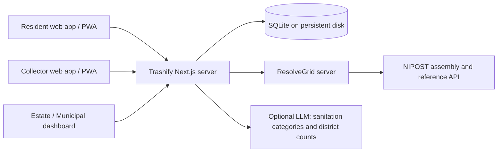

# Trashify

Trashify coordinates waste pickups and sanitation follow-up. Residents book pickups, approved collectors confirm collection with a PIN, and invited estate and municipal teams review service reliability and resident reports. The project originated with the team's public-health lead, a PhD student in public health. ResolveGrid is the team's own postcode integration layer.



## Current pilot

With `TRASHIFY_PILOT_STRUCTURE_MODE=1`, exact postcodes are checked by ResolveGrid using official NIPOST disassembly plus state, LGA, district and area lists. The result is labelled **NIPOST_STRUCTURE_VERIFIED**. This verifies postcode syntax and administrative membership. Building existence and location verification await suitable access. Unit numbers are checked structurally only.

The interface states “Postcode structure verified with NIPOST. Building verification pending live access.” Real pilot bookings also use a resident-supplied pickup position. That position is recorded as a pilot pin. The existing strict geometry/reverse-match path is used when pilot mode is disabled.

Test-key building lookups currently return `not_found`; search and reverse calls return empty results. Do not use local fixture `FC-02-A09-DB-09` as evidence of an official building match. No registered company or live key is claimed.

## Run and test

Node **22.13 or newer** and pnpm 10 are required.

```sh
pnpm install
pnpm dev
```

For release checks, run `pnpm lint`, `pnpm build` and `pnpm test:pilot` in that order. The automated pilot tests use an isolated database and stub upstream services. Live integration checks and physical-device installation are additional checks.

## Configuration

Put secrets in `.env.local` locally or in `.env` next to `compose.yaml` for Docker. Both files are ignored by Git.

| Variable | Purpose |
| --- | --- |
| `TRASHIFY_ORIGIN` | Exact public HTTPS origin, without a trailing slash. |
| `TRASHIFY_DB_PATH` | Persistent SQLite path; defaults to `.data/trashify.sqlite`, or `/data/trashify.sqlite` in Docker. |
| `RESOLVEGRID_API_URL` | Full ResolveGrid resolver URL, normally `https://resolvegrid.aetherhost.com.ng/api/v1/resolve`. |
| `RESOLVEGRID_SERVICE_TOKEN` | Private shared token, set identically on both servers. |
| `TRASHIFY_PILOT_STRUCTURE_MODE` | `1` enables the labelled structure-verification pilot. Default `0` uses strict lookup. |
| `RESOLVEGRID_NIPOST_API_KEY` | Optional override for strict lookup; prefer configuring NIPOST on ResolveGrid. |
| `TRASHIFY_ALLOW_SAMPLE_ADDRESSES` | `1` permits local fixtures for a separate test deployment. |
| `OPENAI_API_KEY` | Optional AI provider credential; both features have deterministic fallbacks. |
| `TRASHIFY_AI_MODEL` | Structured-output model, default `gpt-4.1-mini`. |
| `TRASHIFY_CLIENT_IP_HEADER` | Optional proxy-inserted client IP header. The proxy must strip client-provided values. |

## Accounts and demo

Residents register directly and optionally join an estate using an email-bound invitation. Collectors register pending approval. Estate and municipal users require an invitation scoped to an estate or digital postcode district. Cookies hold an opaque session token. Passwords are hashed, sessions are stored server-side, and data access is scoped in the API.

The public `/demo` link opens four isolated workspaces for two hours without sign-up. It uses sample records and simulated collection location. The demo's sample postcode is `FC-01-A01-KP-27`. With the pilot flag and ResolveGrid configured, new demo bookings make an actual NIPOST structure check; if the service is unavailable, the demo falls back to clearly labelled sample data. Preloaded records are sample data. A new booking's PIN appears in resident tracking; preloaded pickups use `4821`.

Operator commands run against the same database as the server:

```sh
pnpm access invite estate manager@example.test sunrise-estate
pnpm access invite resident resident@example.test sunrise-estate
pnpm access invite municipal officer@example.test FC-01-A01
pnpm access approve collector@example.test FC-01-A01 VERIFIED-LICENCE "Mini truck" mixed,plastics
pnpm access reset resident@example.test
pnpm access revoke collector@example.test
```

Give invitations and reset codes privately after checking the recipient's identity. Email delivery and resident email verification are manual in this pilot.

## AI and public health

Two optional features are implemented. A resident's plain-language description is reduced to allowlisted sanitation signals before a model suggests a report category. The resident reviews it before filing. Raw descriptions are not stored in reports or sent to the model. Dashboard summaries use district counts only, with sentences populated from verified dashboard figures. AI-assisted output is labelled, and no-key or failure cases use rules.

The dashboard measures pickups due, on-time collection, overdue pickups, median hours to collect, and sanitation-report follow-up. CSV exports omit districts with fewer than five due pickups. See [pilot methods](PUBLIC_HEALTH.md), the `/public-health` page and `/privacy`.

## Deploy

Deploy the updated ResolveGrid API first and set its private service token and NIPOST key. Set the same service token on Trashify. Then:

```sh
docker compose up -d --build
```

The container listens on localhost port 3000 (override with `TRASHIFY_PORT`). Put an HTTPS reverse proxy in front of it. Attach the named database volume, run one instance per database, and maintain SQLite-aware backups. Operator commands in Docker use `docker compose exec trashify node scripts/access.mjs ...`.

Routes include `/book`, `/pickups`, `/track/[jobId]`, `/jobs`, `/active/[jobId]`, `/dashboard`, `/demo`, `/public-health`, `/privacy`, `/login`, `/register` and `/reset`. Booking prices are estimates. The app has no payment processing, wallet payouts, camera proof, carbon-credit accounting or predictive ETA model. The mobile deliverable is an installable PWA with an offline reconnect page. See [mobile checklist](MOBILE_APP_GUIDE.md).

## Roadmap after company registration

Complete CAC registration, then NIPOST business verification under the exact registered name. Obtain approved live keys and Postcode Autofill access. Validate building-level lookup and geometry, introduce payments with appropriate operational controls, and evaluate route prediction using verified pilot data. The pitch application should identify the applicants as a team.
